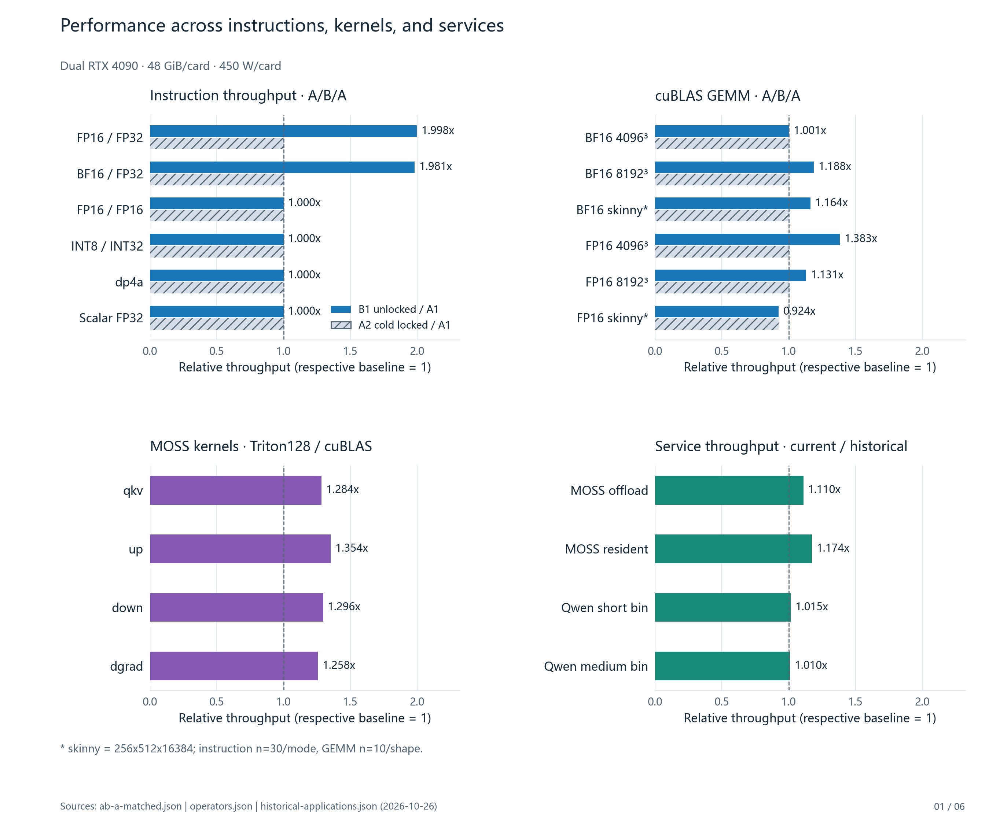
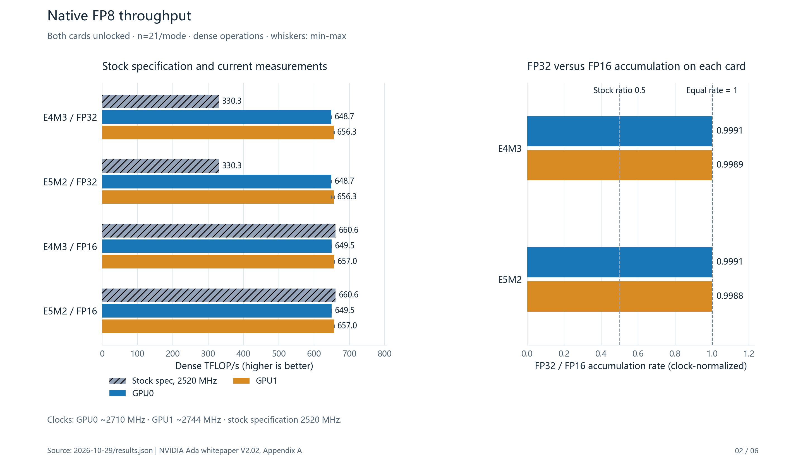
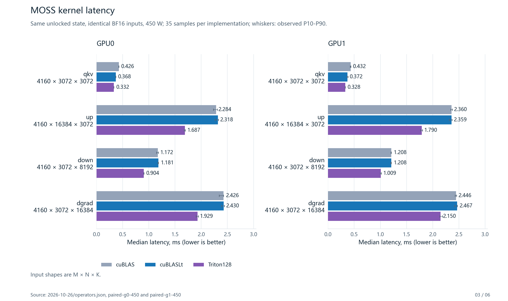
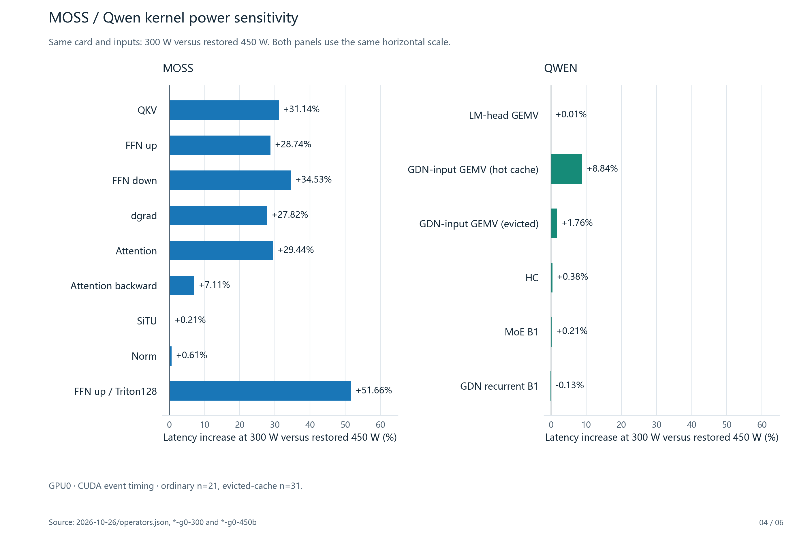
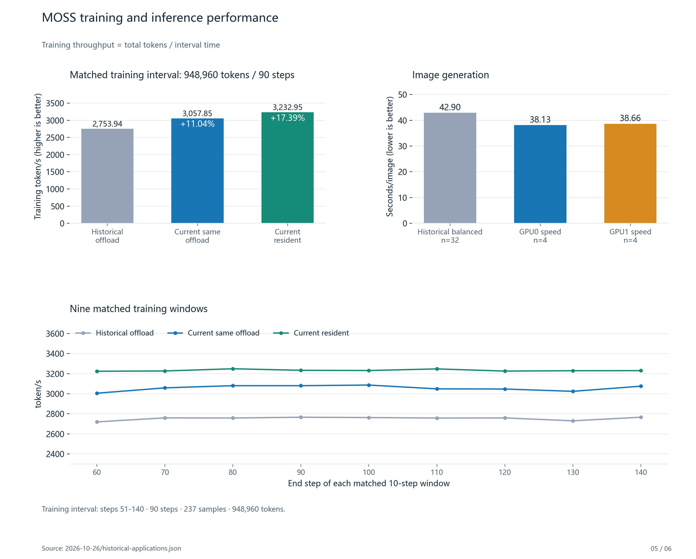
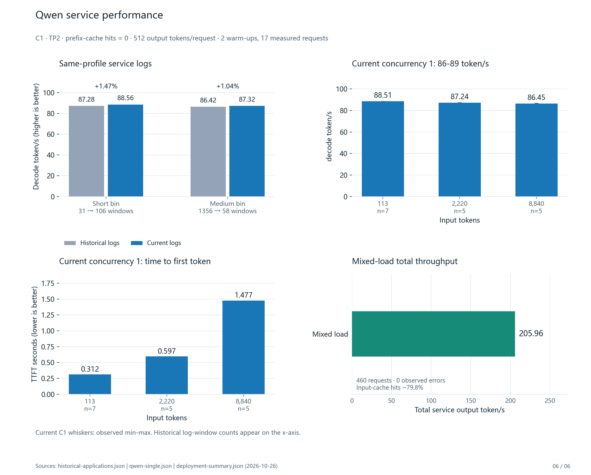

[English](README.md) | [简体中文](README.zh-CN.md)

# Benchmark and production performance charts

These figures use the fixed [October 26](../2026-10-26/README.md) and [October 29](../2026-10-29/README.md) evidence.
They add no new GPU or service measurements.
“Current” means the current run in those records, not a live server reading.
Kernel means a GPU operator kernel here. The Linux kernel stayed at `7.0.0-34-generic`; there is no kernel-version comparison.

[English PDF, 6 pages](output/pdf/benchmark-production-comparison-en.pdf) ·
[Chinese PDF, 6 pages](output/pdf/benchmark-production-comparison-zh-CN.pdf) ·
[CSV](chart-data.csv) · [JSON and source hashes](chart-data.json)

| Figure | Comparison | Evidence boundary |
|---|---|---|
| 01. Overview | Instructions, cuBLAS, implementation choices, and service history | Each panel uses its own baseline |
| 02. FP8 | Stock specification, native measurements, and accumulation modes | No local locked FP8 arm; clocks differ |
| 03. MOSS kernels | cuBLAS, cuBLASLt, and Triton on both cards | Synthetic production shapes; Triton not deployed |
| 04. Power sensitivity | 300 W versus restored 450 W | A power experiment, not an unlock speedup |
| 05. MOSS service | Training throughput and image generation | NUMA, logging, policy, and profile differences remain |
| 06. Qwen service | Historical bins, C1 decoding, TTFT, and mixed service throughput | No comparable historical total-throughput baseline |

Ratios use the specified baseline. They do not imply a significance test.
Whiskers show observed ranges or P10-P90, as labeled. They are not confidence intervals.
The figures retain the negative FP16 skinny-GEMM result and the Qwen cache-eviction exception.
The mixed Qwen workload has no comparable historical total-throughput baseline. Its chart therefore shows an absolute value only.

## Figures

### 01. Performance overview



[SVG](output/en/01-overview.svg)

### 02. FP8



[SVG](output/en/02-fp8.svg)

### 03. MOSS production-shaped kernels



[SVG](output/en/03-moss-kernels.svg)

### 04. Power sensitivity



[SVG](output/en/04-power-sensitivity.svg)

### 05. MOSS service



[SVG](output/en/05-moss-service.svg)

### 06. Qwen service



[SVG](output/en/06-qwen-service.svg)

## Regenerate

Use Python with the packages in [requirements.txt](requirements.txt) in an isolated environment.
The [renderer](render_charts.py) reads committed evidence and the selected [deployment summary](deployment-summary.json).
It writes PNG, SVG, CSV, JSON, and two six-page PDFs under this directory.
It does not access hardware, start workloads, or contact a service.

```sh
python benchmarks/charts/render_charts.py
```

On Windows, the renderer uses Microsoft YaHei when available.
On other systems, install Noto Sans CJK SC or supply a CJK font with `--font /path/to/font`.
The SVG files contain glyph paths. The PDFs embed font subsets.
The [artifact manifest](artifact-manifest.json) lists outputs and source hashes.
