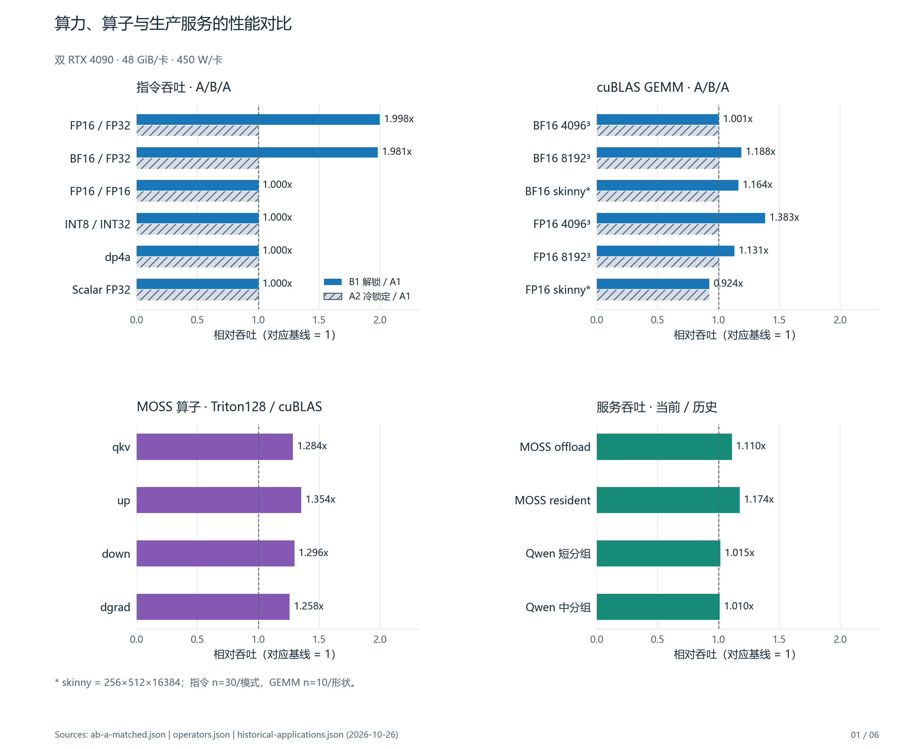
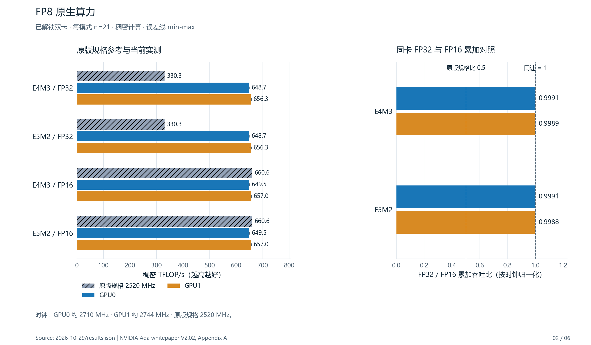
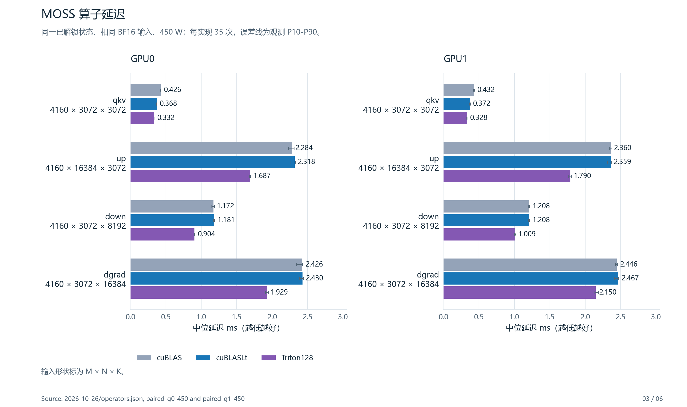
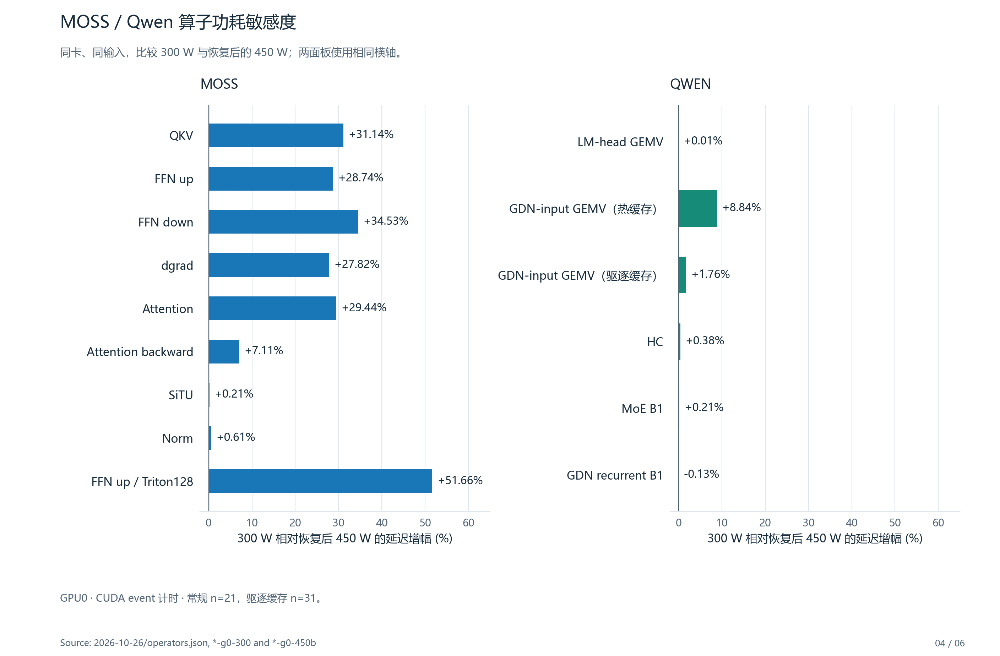
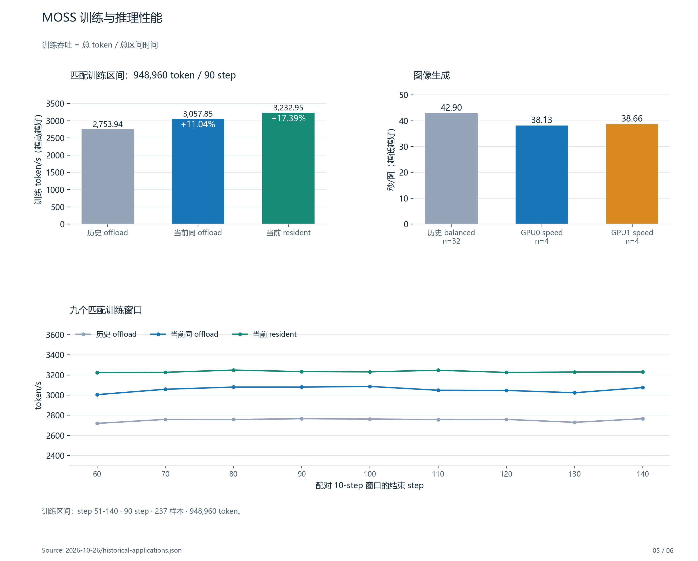
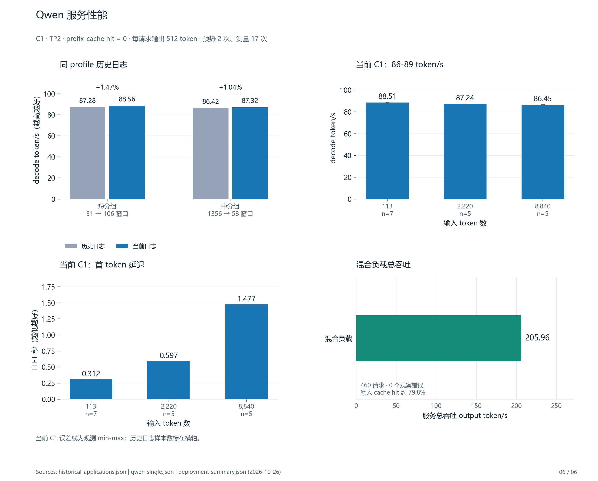

[English](README.md) | [简体中文](README.zh-CN.md)

# 跑分与生产性能图册

图表采用固定的 [10 月 26 日](../2026-10-26/README.zh-CN.md)和 [10 月 29 日](../2026-10-29/README.zh-CN.md)证据，未新增 GPU 或服务测量。
“当前”表示这些记录中的当前组，不是服务器实时读数。
这里的“内核”指 GPU 算子 kernel；Linux 内核固定为 `7.0.0-34-generic`，没有内核版本间对比。

[中文 PDF，6 页](output/pdf/benchmark-production-comparison-zh-CN.pdf) ·
[英文 PDF，6 页](output/pdf/benchmark-production-comparison-en.pdf) ·
[CSV 数据](chart-data.csv) · [JSON 和来源哈希](chart-data.json)

| 图 | 对比内容 | 证据边界 |
|---|---|---|
| 01. 总览 | 指令、cuBLAS、实现选择和服务历史 | 各面板采用各自基线 |
| 02. FP8 | 原版规格、实机结果和累加模式 | 无本机锁定 FP8 组，时钟也不同 |
| 03. MOSS 算子 | 双卡 cuBLAS、cuBLASLt、Triton | 合成生产形状，Triton 尚未部署 |
| 04. 功耗敏感度 | 300 W 与恢复后 450 W | 功耗实验，不是解锁倍率 |
| 05. MOSS 服务 | 训练吞吐和图像生成 | 仍有 NUMA、日志、策略和 profile 差异 |
| 06. Qwen 服务 | 历史分组、C1 解码、TTFT 和混合服务总吞吐 | 无可比的历史总吞吐基线 |

所有比值均对应明确基线，不代表显著性检验。
误差线按图中标签表示观测范围或 P10-P90，不是置信区间。
图中保留了 FP16 skinny GEMM 的负面结果，以及 Qwen 驱逐缓存后的例外。
Qwen 混合负载缺少可比的历史总吞吐基线，因此只展示绝对值。

## 图表

### 01. 性能总览



[SVG](output/zh-CN/01-overview.svg)

### 02. FP8



[SVG](output/zh-CN/02-fp8.svg)

### 03. MOSS 生产形状算子



[SVG](output/zh-CN/03-moss-kernels.svg)

### 04. 功耗敏感度



[SVG](output/zh-CN/04-power-sensitivity.svg)

### 05. MOSS 服务



[SVG](output/zh-CN/05-moss-service.svg)

### 06. Qwen 服务



[SVG](output/zh-CN/06-qwen-service.svg)

## 重新生成

在独立 Python 环境安装 [requirements.txt](requirements.txt) 中的依赖。
[绘图程序](render_charts.py)读取已提交证据和选取的[部署摘要](deployment-summary.json)，生成 PNG、SVG、CSV、JSON 和两份六页 PDF。
程序不访问硬件、不启动负载，也不请求服务。

```sh
python benchmarks/charts/render_charts.py
```

Windows 上优先使用 Microsoft YaHei。
其他系统请安装 Noto Sans CJK SC，或用 `--font /path/to/font` 指定 CJK 字体。
SVG 包含字形路径；PDF 嵌入字体子集。
[产物清单](artifact-manifest.json)列出输出文件及来源哈希。
